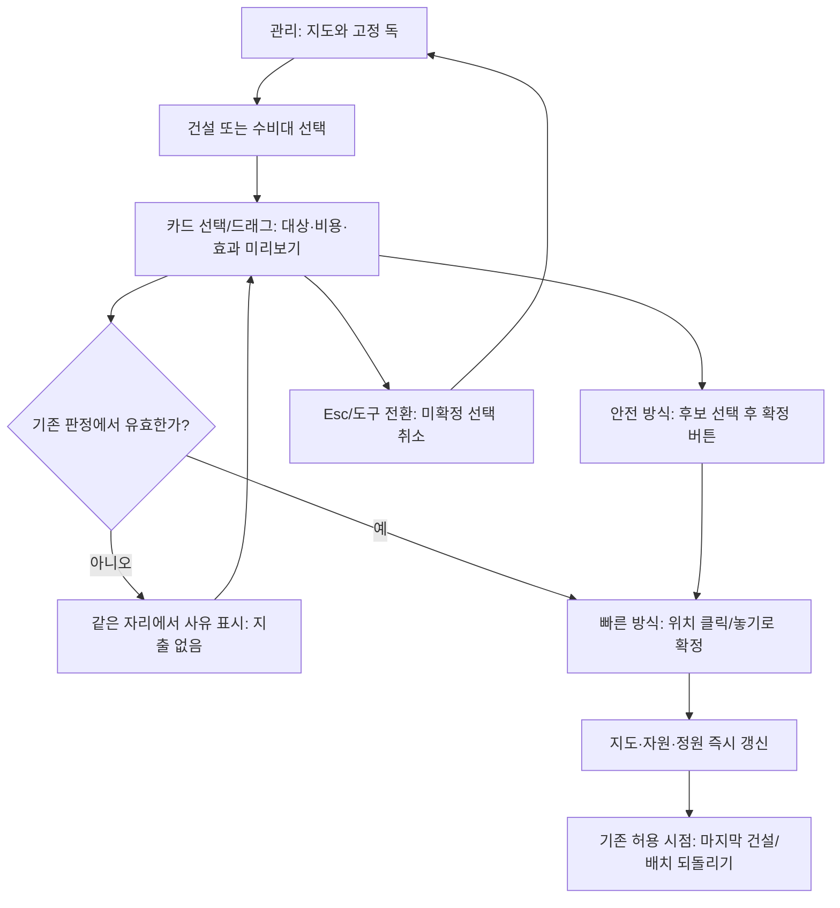
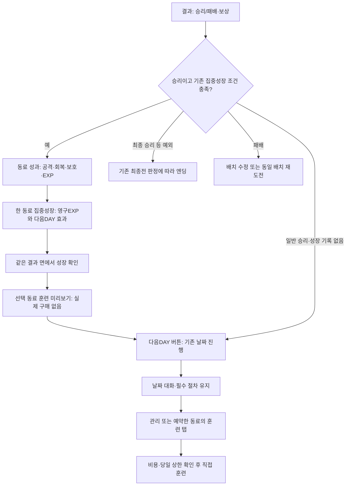

# 마왕성 U2 — 정보 구조(IA)·화면 흐름 재설계

작성일: 2026-10-14 · 상태: **설계 제안, 사용자 흐름 결정 대기** · 작업 이름: v1213_uiux

## 먼저 읽는 요약

- 현재 화면 상수 29종을 **15개 화면 틀**로 정리한다. 관리에는 침입 예고·출진 대기를 붙이고, 몬스터에는 성장·편성·합동기·기억·동료 도감을 모은다. 엔딩과 회차 기록은 별도 기록실에 남긴다. 기능이나 해금 절차를 삭제하는 안이 아니다.
- 관리의 기본 구조는 **상단 자원 바 + 하단 건설/수비대/전술/몬스터/전투 시작 독 + 우측 접이식 상세**다. 수비대는 “어디에 배치할까”, 몬스터는 “누구를 어떻게 키울까”를 담당한다.
- 결과에서 동료 성과를 보고 집중성장을 선택한다. 같은 동료의 훈련 미리보기를 이어 보여주되, 실제 훈련은 기존 날짜 진행·대화·필수 절차를 거친 관리 단계에서 실행한다. 보상·훈련 횟수·해금일을 앞당기지 않는다.
- 감사의 첫 DAY 경로는 51클릭이며 대화가 36클릭이다. **화면 통합만 적용하면 48클릭(5.9% 감소)**으로, 30% 목표를 충족하지 못한다. 긴 대화 네 묶음의 선택형 자동 재생을 함께 승인하면 **목표 28클릭(45.1% 감소)**이다. 대사를 줄이거나 짧은 전투 대화 세 번을 없애는 절감은 이 수치에 포함하지 않았다.
- U4에서 공통 틀·높이 계산·입력·레이어를 먼저 만든 뒤 U5에서 화면별로 교체한다. 기존 함수의 대상 검사, 저장 형식, 튜토리얼 필수 행동, 전투 일시정지와 보상 지급은 보존한다.

IA는 “정보를 어디에 두고 어떤 순서로 찾게 할지”를 정하는 설계다. 독은 화면 아래에 고정되는 주요 메뉴, HUD는 플레이 중 지도 위에 보이는 상태·조작 정보다.

## 0. 근거와 범위

### 읽은 자료와 기준 시안

| 자료 | 이번 설계에 사용하는 근거 |
|---|---|
| [전면 개편 계획](UIUX_OVERHAUL_PLAN_2026-10-14.md) | 한 화면 1~2개 결정, 지도 80% 이상, U4→U5 순서, 게임 규칙·밸런스·저장 구조 보존 |
| [UX 진단 전체](UX_AUDIT_2026-10-14.md) | 화면 29종, 핵심 루프 실측, C01~C09, D01~D09, 실제 교체 함수 목록 |
| [수정 체크리스트 부록 A](../../plans/V1213_FIX_CHECKLIST_2026-10-14.md) | 사용자 원문 37개와 후속 정정. 특히 #13~18·#37의 성장 의미와 조건 표시 |
| [관리 A 시안](kit/screen_management_A.png) | 얇은 상단 자원 바·하단 5항목·우측 상세 손잡이. 지도 구조나 시안 속 수치는 구현 근거로 삼지 않음 |
| [타이틀 v3](../v1213_screens/v1213_title_v3.png) | 중앙 메뉴, 다수 동료 그림, 우하단 자국어 언어 선택 |
| [대화 v4](../v1213_screens/v1213_dialogue_v4.png) | 좌우 큰 참여자, 화자 강조, 하단 넓은 대사 띠, 우상단 로그/자동/넘기기 |

시안은 배치 참고다. 스타일 A/B와 바티 체형의 확정 여부는 이 문서에서 결정하지 않는다. #34는 대화 배경에 관한 정정이며 관리 던전 배경의 교체 지시로 확대하지 않는다.

원문 #10/#19의 난이도, #18의 경험치 증량, #24의 BGM 순환은 기존 별도 작업에 남긴다. 이 설계는 해당 밸런스·음악 항목의 완료를 선언하지 않으며 37개 요구사항을 삭제하거나 기존 체크리스트 상태를 바꾸지 않는다.

### 기준의 한계

감사에 기록된 기준은 제품 1.2.12, 감사 SHA `45eb92541edb4e8bf7bb840a0fb13e1e1296a741`다. 이는 **감사 문서의 기준**이며 이번 세션의 HEAD 확인값이 아니다. 다른 작업자가 같은 작업본을 수정·커밋하고 있어 사용자 지시에 따라 git 명령, 코드 수정, 실행 빌드, 별도 핸드오프/CURRENT 수정은 하지 않는다. 이 파일만 헤드에게 전달한다.

코드는 현재 작업본을 읽어 함수·조건을 확인했다. 감사 뒤 S1/S2 수정이 진행된 기록이 있으므로 감사의 글자 소실·번호·업데이트 팝업이 지금도 전부 재현된다고 단정하지 않는다. U5 착수자는 최신 코드에서 관련 항목만 다시 확인한다. 줄 번호는 변하므로 교체 단위는 파일·함수 이름으로 적는다.

## 1. 화면 목록 Before → After

### 셈의 기준

Before는 [Constants.gd](../../../scripts/core/Constants.gd)의 `SCREEN_*` **29개**다. 설정 분야별 탭, 일시정지 메뉴, 의회·왕관 선택창, 대화 로그, 다층 HUD는 별도 화면 상수가 아니므로 29개에 중복 합산하지 않는다.

After의 A01~A15는 플레이어가 인식하는 화면 틀이다. **유지 13개 / 합치기 14개 / 독립 화면 없애기 2개**로 분류하며, 통합 기록실·회차 준비 틀 2개를 더해 총 15개다. “없애기”도 표시 내용이나 취소 권한의 삭제가 아니라 독립 전면 화면의 제거다. U5에서 화면 상수 29개를 곧바로 15개로 바꾸거나 과거 저장의 화면 ID를 삭제하지 않는다. 기존 상태를 새 틀에 연결하는 표시 계층을 먼저 둔다.

| 번호 | Before: 현재 화면·ID | 분류 | After | 이유 |
|---:|---|---|---|---|
| 01 | 타이틀 `title` | 유지 | A01 타이틀·새 게임 | 시작/복원을 결정하는 안정된 진입점이 필요하다. |
| 02 | 이름 입력 `name_entry` | 합치기 | A01 새 게임 입력 상태 | 타이틀 위 입력 면으로 이어 안내창 왕복을 줄인다. |
| 03 | 대화 `dialogue` | 유지 | A02 대화 | 참여자·대사·로그를 읽는 목적을 보존한다. |
| 04 | 침입 정보 `intrusion_brief` | 합치기 | A03 관리의 오늘 예고 | 적 구성·목표·경로를 지도와 함께 판단하게 한다. |
| 05 | 관리 `management` | 유지 | A03 관리 | 배치·건설·상시 정책의 작업 공간으로 남긴다. |
| 06 | 방어 시작 `defense_start` | 없애기 | A03 출진 대기 띠 | 별도 화면 없이 기존 3초 대기·취소·배치 잠금을 보여준다. |
| 07 | 몬스터 `monster` | 유지 | A04 몬스터 | 동료 목록 고정과 5개 작업 탭으로 성장을 찾게 한다. |
| 08 | 기억 `memory_archive` | 합치기 | A04 기억 탭 | 선택 동료를 다시 찾지 않고 기록을 읽는다. |
| 09 | 계약 `contract_board` | 합치기 | A04 계약·편성 작업 상태 | 영입/출전/예비를 같은 동료 목록에서 다루되 확정 조건은 유지한다. |
| 10 | 합동기 편성 `duo_link_loadout` | 합치기 | A04 합동기 탭 | 참여 동료·조건·장착을 성장 정보와 연결한다. |
| 11 | 전투 `combat` | 유지 | A05 전투 | 지도·목표·즉시 행동을 한 HUD에 모은다. |
| 12 | 결과 `result` | 유지 | A06 결과·동료 성과 | 성과를 읽고 집중성장/다음 준비를 결정한다. |
| 13 | 엔딩 `ending` | 유지 | A07 엔딩 | 최종 결말과 계승·회차 이동의 의미를 분리한다. |
| 14 | 엔딩 도감 `ending_archive` | 합치기 | A08 기록실의 엔딩 | 다시 읽는 기록을 연대기와 같은 틀에 모은다. |
| 15 | 연대기 `chronicle` | 합치기 | A08 기록실의 연대기 | 회차·전선·관계 기록을 정리하고 설정을 분리한다. |
| 16 | 회차 모드 `campaign_mode_selection` | 합치기 | A09 회차 준비의 모드 단계 | 같은 준비 틀에서 현재 결정만 보여준다. |
| 17 | 전선 `front_selection` | 합치기 | A09 전선 단계 | 모드에 따른 기존 선택 순서·효과를 유지한다. |
| 18 | 성의 심장 `heart_selection` | 합치기 | A09 심장 단계 | 선택 결과를 같은 준비 요약에 누적한다. |
| 19 | 왕국 교리 `cycle_doctrine` | 합치기 | A09 교리 단계 | 별도 목록 화면을 공통 비교 면으로 바꾼다. |
| 20 | 마왕 칙령 `cycle_decree` | 합치기 | A09 칙령 단계 | 전역 전술과 다른 회차 규칙임을 명시한다. |
| 21 | 도전 인장 `challenge_seal` | 합치기 | A09 인장 단계 | 이미 정한 준비와 다음 선택을 같은 틀에서 읽는다. |
| 22 | 지역 `region_selection` | 유지 | A10 지역 경로 | 해금된 지역의 적·보상을 비교하는 독립 결정이다. |
| 23 | 전초기지 관리 `outpost_management` | 유지 | A11 전초기지 준비 | 본성 배치와 다른 파견·유형·강화를 구분한다. |
| 24 | 전초기지 전투 `outpost_battle` | 유지 | A12 전초기지 전투 | 별도 전투 규칙과 결산을 본성 전투에 합치지 않는다. |
| 25 | 상층 `upper_floor` | 합치기 | A03 상층 준비 상태 | 층 표시를 관리 틀에 연결하되 고정 연결 선택은 보존한다. |
| 26 | 원정 예고 `raid_preview` | 없애기 | A13 원정의 예고 상태 | 임무 선택 앞에서 같은 안내를 두 번 확인하지 않게 한다. |
| 27 | 원정 `raid` | 유지 | A13 원정 | 임무·참가자·결산을 같은 작업 면에 둔다. |
| 28 | 설정 `settings` | 유지 | A14 설정·접근성 | 표시·조작·전투 연출을 하나의 설정 입구에서 찾는다. |
| 29 | 튜토리얼 연습 `tutorial_practice` | 유지 | A15 조작 연습 | 실제 날짜·자원 소비와 연습을 혼동하지 않게 한다. |

### 동료·기록 진입점 통합

| 현재 진입점 | 새 위치와 목적 | 진입·복귀 규칙 |
|---|---|---|
| 수비대 | A03 수비대: 지도 배치 | 카드의 성장 아이콘은 A04의 같은 동료로 연결. 배치는 여기서만 한다. |
| 몬스터 성장 | 독의 몬스터 → A04 | 수비대 탭을 먼저 열 필요가 없다. 마지막 동료·탭을 유지한다. |
| 계약 동료 | A04 목록의 계약 보기 | 다음 회차 준비 중에는 후보/선택 수/확정·취소를 표시. 평시 재계약을 허용하지 않는다. |
| 출전·예비 편성 | A04 보유 동료 목록의 출전/예비 표시와 편성 작업 면 | `_contract_roster_available()`이 허용할 때만 편집. 소유와 출전 상태를 서로 다른 표식으로 표시한다. |
| 합동기 | A04 합동기 탭 | 선택 동료가 참여하는 조합을 우선 표시. 팀 전체 2슬롯·자동 사용·프리셋은 같은 면의 팀 영역에 둔다. |
| 동료 기억 | A04 기억 탭 | 선택 동료·회차 출처·해금 기억 ID를 유지. 읽기는 행동 재실행이 아니다. |
| 미래 동료 도감 | A04 목록의 도감 보기, A08의 동료 바로가기 | 초상/실루엣·역할·만나는 조건. 보유하지 않은 동료의 훈련·배치 버튼은 없다. |
| 엔딩 도감·연대기 | A08 기록실: 엔딩/연대기 | 동료 항목 클릭 시 A04 기억/도감으로 이동하고 기록실의 선택 위치로 돌아온다. |

동료 목록의 **보유 / 도감 / 계약**은 목록 범위를 바꾸는 선택이다. 훈련까지 “보유→동료→훈련”을 매번 강요하지 않는다. 독의 몬스터는 바로 보유 목록·훈련 탭을 열고, 필수 특화가 있으면 스킬 탭으로 가는 명확한 바로가기를 함께 보여준다.

미해금 정보는 기존 카탈로그가 허용하는 실루엣·역할·조건만 노출한다. 엔딩 이름·본문·배경과 미해금 기억 본문은 공개하지 않는다. 새 동료 수·영입 비용·첫 회차 편성을 늘리지 않는다.

### 설정·접근성 통합

A14의 분야는 **화면 / 소리 / 조작·접근성 / 대화·안내 / 전투 연출**로 정리한다. 연대기의 표시·조작 면은 제거하고 A14 해당 분야 바로가기만 남긴다.

- 화면: 창 모드, 글자 배율, 배치 방식. 소리: 기존 음량, 층 경보 음량.
- 조작·접근성: 입력 방식, 층 전환 키, 고대비 위험 아이콘, 숨은 층 전투 요약, 지역 추가 정보, 지도 움직임 감소.
- 대화·안내: 언어, 튜토리얼 수준·이력·연습, 빠른 대사 옵션. 새로운 첫 회차 자동/넘기기 정책은 §9 결정 사항이다.
- 전투 연출: 기존 컷신 정책, 효과 감소, 배속 기억. 전투 명령/특화를 설정에 섞지 않는다.

`_set_update4_accessibility()`는 현재 캠페인 프로필을 쓰고, 일반 설정은 `settings_open_snapshot`과 적용/취소를 사용한다. 같은 메뉴로 옮긴다고 저장소가 자동으로 합쳐지지는 않는다. 새 UI는 접근성도 임시 값으로 편집하고 **적용 시 기존 저장 함수**, 취소 시 기존 값 복원을 사용한다. 기존 키·정규화·파일 형식은 유지한다. 저장 실패 시 면을 유지하고 재적용/취소를 제공한다. 연대기에서 설정을 바꾸거나 두 곳에 같은 값을 보관하지 않는다.

## 2. After 화면별 단일 목적·정보 우선순위

아래 “첫 화면”은 우선순위 ①→②→③ 순서다. 결정에 필요한 비용·잠금 이유·대상·되돌릴 수 없는 선택은 툴팁에만 숨기지 않는다. 탭이 있는 틀에서도 현재 열린 작업만 1~2개의 결정을 맡는다.

| After | 플레이어가 여기서 하는 결정 1~2개 | 첫 화면에 보이는 정보 | 펼치기·툴팁으로 내릴 정보 |
|---|---|---|---|
| A01 타이틀·새 게임 | 시작할지/저장에서 계속할지; 새 게임이면 이름 확정 | ① 중앙 새 게임·이어하기와 저장 상태 ② 입력 중 이름·유효성·확정 ③ 설정·도감·종료, 우하단 한국어/English/简体中文 | 업데이트 내역, 저장 상세, 이름 입력의 긴 설명. 진행 손실 경고는 해당 행동 때만 |
| A02 대화 | 다음 대사를 읽을지; 자동/허용된 넘기기를 쓸지 | ① 대사·화자 ② 좌우 참여자·화자 밝기 ③ 로그·자동 상태·넘기기 가능 여부 | 조작 설명, 읽기 전용 로그. 대사 번호를 다시 넣지 않음 |
| A03 관리 | 현재 도구로 어디에 무엇을 준비할지; 준비 후 전투를 시작할지 | ① 지도·배치/설치 가능 표식 ② 날짜·적 아이콘×수·목표 HP·자원 ③ 선택 도구의 비용/정원·막힌 준비 | 전 편대 일정, 시설 전체 수치, 경로 상세, 지난 공지·이력 |
| A04 몬스터 | 성장 작업의 대상·내용 선택; 편성 작업이면 출전/조합 확정 | ① 고정 동료 목록·선택 이름/레벨/역할 ② 현재 탭의 전후 비교·비용·조건 ③ 영구/다음 전투 표식·사용 횟수/상한 | 전체 능력치, 긴 스킬 설명, 다른 동료의 조합, 해금된 기억 본문. 계약 모드에서는 성장 면 대신 후보 비교를 표시 |
| A05 전투 | 명령의 대상 결정; 유닛 스킬/합동기의 발동 결정 | ① 지도·위협·목표 HP ② 하단 즉시 행동·비용/재사용 대기 ③ 선택 대상·현재 정책·고정 배속 | 상세 전투 로그, 모든 유닛 통계, 정책의 긴 설명 |
| A06 결과·동료 성과 | 집중성장할 동료 선택; 다음 준비/패배 재도전 선택 | ① 성공/실패·보상 ② 승리 초상·각 동료 대표 공격/지원 성과 ③ 경험치바·집중성장 전후·다음 방어 효과·진행 잠금 | 전투 세부 집계, 공유/활약 EXP 산식, 시설 기여. “성장 확인”은 아래 읽기 절차로 유지 |
| A07 엔딩 | 후일담을 볼지; 계승 후 다음 회차/타이틀로 갈지 | ① 도달한 결말 ② 이번 계승 결과 ③ 가능한 다음 행동 | 도달한 엔딩 본문 재열람·세부 통계. 미도달 결말은 노출하지 않음 |
| A08 기록실 | 엔딩/회차 기록 선택; 해당 동료 기록으로 이동 | ① 기록 분야·해금 목록 ② 선택 기록의 제목/날짜/회차 ③ 본문과 동료 바로가기 | 상세 지표, 긴 관계 이력. 설정 값은 여기에 두지 않음 |
| A09 회차 준비 | 현재 단계의 선택 확정; 기존 절차가 허용하면 이전 단계로 복귀 | ① 지금 결정할 모드/전선/심장/교리/칙령/인장 ② 2~3개 비교와 잠금 이유 ③ 확정된 준비 요약·다음 단계 | 장문 효과·예외. 선택 순서를 유지하며 모든 항목을 한꺼번에 확정하지 않음 |
| A10 지역 경로 | 다음 지역 선택 | ① 해금 경로·위협 ② 적·핵심 보상·진입 조건 ③ 선택 후 변화 | 지역 장문 규칙·인장 조건 전체. 미충족 진입 조건은 첫 화면에도 표시 |
| A11 전초기지 준비 | 유형/강화 선택; 파견 동료 결정 | ① 해당 거점·목표 ② 유형/강화 전후·비용 ③ 현재 파견/정원 | 모든 거점 이력·긴 유형 효과. 본성 출전과 파견 상태를 구분 |
| A12 전초기지 전투 | 상황을 확인하고 결산 뒤 복귀 | ① 깃발/목표 HP·전황 ② 파견 성과 ③ 결산/복귀 | 상세 사건 로그. 현재 없는 본성 명령·수동 스킬을 새로 추가하지 않음 |
| A13 원정 | 임무 선택; 참가자·비용 확인 후 출발 | ① 임무 목표/보상/위험 ② 참가자·자원 비용 ③ 출발 또는 결산 후 준비 복귀 | 예고 장문·역할 계산 근거. 의무 원정은 잠금 이유와 바로가기 유지 |
| A14 설정·접근성 | 설정 값을 조절할지; 적용/취소할지 | ① 현재 분야와 값 ② 변화 미리보기 ③ 적용/취소·저장 오류 | 긴 효과 설명, 현재값의 중복 요약. 재설정·안내 이력 삭제는 해당 확인 때만 |
| A15 조작 연습 | 연습 과제를 수행할지; 종료하고 원래 화면으로 돌아갈지 | ① 연습 표시·과제 ② 조작 대상 ③ 완료/복귀 | 이미 완료한 과제 설명. 실제 날짜/자원/배치가 변하지 않음을 표시 |

### 남기는 겹침 면의 목적

| 겹침 면 | 결정·첫 정보 | 아래로 내릴 정보/복귀 |
|---|---|---|
| 일시정지 메뉴 | 계속/저장/불러오기·이동 중 하나 선택; 복원 체크포인트와 저장 가능 여부 | 설정은 A14로. 닫으면 원래 화면·원래 일시정지 상태 복원 |
| 진행 손실 확인 | 저장 후 이동/저장 없이 이동/취소; 잃는 진행과 목적지 | 저장 실패면 이동하지 않고 오류를 표시. 저장 제한을 없애지 않음 |
| 의회 의제·표결 | 의제 또는 현재 의제의 찬성/수정/반대; 예상 효과 | 회기 상세는 펼치기. 기존 선택 순서·필수 확정 유지 |
| 왕관 선택 | 후보 진화 또는 대체 보상; 모습·효과·비용·부족 조건 | 긴 설명은 펼치기. 후보 없음도 이유와 기존 대체 선택을 제공 |
| 최종 선언 | 기존 선언 하나 확정; 약속·효과 | 관련 긴 이력은 펼치기. 관리의 전투 시작 잠금과 연결 |
| 성장 확인 | 집중성장 적용 결과 확인; EXP 전후·다음 효과 | 별도 훈련 화면으로 오인시키지 않고 결과 안에서 확인 완료 |
| 대화 로그 | 기록 선택·읽기; 날짜·화자·본문 | 닫으면 같은 대사/선택/자동 타이머 맥락. 기록에서 보상/이벤트 재실행 금지 |
| 툴팁·알림 | 설명 또는 성공/실패 확인; 대상 이름과 짧은 사유 | 비용 지출·성장·새 화면 전환을 알림 클릭 없이 자동 실행하지 않음 |

## 3. 내비게이션과 관리 상호작용

### 고정 골격

상단에는 자원 아이콘+수치, 날짜, 오늘 적 아이콘×수량, 왕좌/보관실 등 **현재 규칙에서 실제 보호하는 목표**의 HP바를 둔다. 메뉴·설정·기록 아이콘은 오른쪽 끝이다. 자원의 장문 설명·전 편대 일정은 펼치기로 이동한다.

건설에서는 시설을 설치한 슬롯 수/현재 열린 설치 가능 슬롯 수를, 수비대에서는 구역별 현재 인원/정원을 표시한다. 시설 종류별 제한이 실제로 있는 경우만 별도로 표시하며 빈 슬롯 수를 새 건물 수용 규칙으로 만들지 않는다. 감시 초소 선택 시 실제 효과가 적용되는 구역을 강조하고, 가시 복도는 `고정 구역 · 건설 대상 아님`으로 구분한다. 시설 강화의 현재/다음 레벨·수치·비용과 불가 사유는 같은 상세에서 읽게 한다. 범위 그림은 실제 구역/경로 판정을 사용하고 임의의 반경 원을 그리지 않는다.

하단 독은 **건설 / 수비대 / 전술 / 몬스터 / 전투 시작**의 순서를 고정한다. 앞의 세 항목은 지도 도구를 바꾸고, 몬스터는 A04로 이동하며, 전투 시작은 기존 준비 검사 후 출진 절차를 시작한다. 막힌 전투 시작은 이름을 “몬스터 성장” 등으로 바꾸지 않고 잠금 사유와 해당 작업 바로가기를 붙인다.

우측 상세는 선택한 **방 또는 동료 한 대상**만 다룬다. 방에서는 시설/강화/방 지침을, 동료에서는 배치 상태와 몬스터 바로가기를 보여준다. 다른 대상을 클릭하면 상세 내용이 바뀌며 “닫기→다른 대상→다시 열기”를 요구하지 않는다. 필수 선택창이 떠 있을 때는 기존 차단을 따른다.

기본 지도 가시 면적은 80% 이상을 목표로 한다. 상세·카드가 열린 상태는 별도 측정하며 “뒤에 지도가 렌더링됨”을 가시 면적으로 세지 않는다. 작은 화면과 터치에서는 하단 카드/상세가 독·배속을 덮지 않게 같은 예약 공간을 교대로 쓰고, 긴 내용은 스크롤한다. 글자를 줄여 억지로 80%를 맞추지 않는다. 확대·이동·지도 전체 버튼과 키보드/터치의 대체 조작도 유지한다.

### “탭→카드→대상→검토→확정” 줄이기

| 행동 | 새 상호작용 | 확정/취소·되돌리기 |
|---|---|---|
| 건설: 클릭 경로 | 건설1 → 카드1 → 후보 위치1. 카드 선택 후 위치를 가리킬 때 비용·효과·경로·대체 시설을 즉시 미리보기 | **빠른 설치 승인 시** 유효 위치 클릭이 확정. 마지막 건설은 기존 되돌리기. 안전형은 후보 클릭 뒤 확정1을 유지 |
| 건설: 드래그 경로 | 건설1 → 카드 끌기. 이동 중 유효 위치와 같은 미리보기 표시 | 놓기를 한 번의 확정으로 처리하는 안. 잘못된 위치는 미지출·선택 유지. 드래그는 클릭 절감 실측과 따로 기록 |
| 선택한 방의 시설 교체 | 선택된 방을 유지한 채 새 카드 비교. 방을 다시 찍게 하지 않음 | 같은 설치 판정과 유일 시설의 기존 위치 비움까지 미리 표시. 안전형 확인 또는 빠른 확정 정책 적용 |
| 동료 배치 | 수비대 카드→방, 또는 카드 드래그→방. 정원 현재/최대와 배치 후 인원을 즉시 표시 | 기존 배치 콜백·마지막 배치 되돌리기. DAY1 푸딩/핀 고정과 곱의 전열/후열 제한 유지 |
| 시설 강화 | 선택 방 상세에 현재 레벨→다음 레벨·수치·비용 표시, 강화 버튼1 | 기존 강화 판정·지출. 확인된 배치 되돌리기를 강화에 적용하지 않음 |
| 방 지침 | 방1 → 현재 방에 유효한 지침 칩1. 칩은 짧은 이름이 붙은 선택 버튼 | 기존 `_set_room_directive()`로 적용. “선택기 열기→항목 선택” 두 클릭을 하나로 줄임 |
| 전역 지침 | 전술에서 성 전체 정책을 바로 선택 | 적용 범위와 기존 변경 가능 시점 유지. 방 지침과 구분 |
| 도구 전환 | 다른 독 항목1로 미확정 미리보기를 취소하고 새 도구 시작 | 미확정 건설은 지출 없음. 이미 확정된 건설·성장·계약은 취소하지 않음 |

미리보기는 비용을 지불하거나 보상을 지급하지 않는다. 확정 직전에 `_evaluate_facility_placement()`와 기존 정원·튜토리얼·해금 검사를 다시 사용한다. 포인터 이벤트가 버튼과 지도에 중복 전달되어 2회 확정되지 않아야 한다. 카드 선택만으로 지출하는 동작은 없다.

빠른 드롭도 포인터를 놓은 뒤 기존 `pointer_active`/`committing` 상태를 정리해 확정 경로로 들어가야 한다. `_confirm_build_preview()`의 중복 확정 방어를 제거하거나, 미리보기 갱신 중 지출 함수를 직접 호출하는 구현은 하지 않는다.

`_capture_management_undo()`/`_undo_last_management_placement()`는 방·동료·자원·연결 상태의 마지막 변경을 복원한다. 현재 건설, 방/길목 배치, 샛문 복구에서 사용하며, 튜토리얼·스토리 읽음·관찰 이력 전체를 되감는 기능은 아니다. **새 설치/배치가 다음 대화나 필수 절차를 일으켰다면 그동안 새 되돌리기 입구를 열지 않는다.** 기존 허용 시점에만 제공하고, 전투 진입·화면 이동 때 수명이 끝나는 기존 동작을 확대하지 않는다. 성장·특화·전직·왕관에 “되돌리기”를 약속하지 않는다.

## 4. 성장 흐름 — 성과부터 다음 준비까지

### 결과에서 끊기지 않는 동료 맥락

결과는 **승리·보상 → 동료 성과 → 집중성장 전후 → 다음 준비** 순서다. 공격량만으로 동료의 우열을 표시하지 않는다. 기존 실제 회복·보호·지원·합동기 성과와 관련 초상을 사용하며, 계산되지 않은 기여를 새 점수로 만들지 않는다. 전체 집계는 펼치기로 내려 대표 성과와 경험치바가 먼저 보이게 한다.

집중성장 버튼을 고르면 기존 결과 화면 안에서 지급·선택 잠금을 처리한다. “성장 확인”은 EXP 전후와 다음 방어 효과를 확인하는 같은 면의 버튼이다. 이를 자동 완료하거나 다음 DAY 버튼에 합치는 안은 §9의 튜토리얼 결정 전에는 적용하지 않는다.

결과의 선택 동료에 훈련 **미리보기/바로가기**를 붙인다. 권장 흐름은 “같은 동료의 다음 준비 보기 → 성장 확인 → 다음 DAY → 날짜 대화/기존 필수 절차 → 훈련 탭”이다. DAY를 넘기는 입력은 명시적으로 남기며, 바로가기는 훈련을 자동 구매하지 않는다. DAY1 결과에서 원래 접근하지 못하던 실제 유료 훈련을 새로 실행하면 날짜별 상한·경험치·전투 준비를 바꿀 수 있으므로 허용하지 않는다.

기존 `_choose_result_growth()`는 `current_screen == result`를 요구하고, 훈련·선택 함수는 화면 재구성을 포함한다. 동일한 디자인을 공유하더라도 집중성장은 결과 상태, 실제 훈련은 몬스터 상태로 각각 유지한다. 결과에 몬스터 화면을 통째로 얹어 이 검사를 우회하지 않는다. 다음 준비 바로가기의 대상 동료·탭·복귀 위치는 UI 임시 맥락으로만 넘긴다.

### 몬스터 화면의 고정 목록 + 우측 5탭

동료 목록은 왼쪽에 고정한다. 오른쪽에는 선택 동료의 이름·현재 역할·레벨·유대·출전/예비/지원 전용 상태를 얇은 머리글로 두고 **훈련 / 스킬 / 전직 / 합동기 / 기억** 탭을 둔다. 큰 초상은 탭의 판단 정보를 밀어내지 않는 크기로 배치한다. 터치에서는 목록을 좁은 열 또는 가로 목록으로 바꾸되 동료 이름과 탭이 동시에 읽혀야 한다.

| 탭 | 첫 판단 정보와 행동 | 접는 정보·잠금 처리 |
|---|---|---|
| 훈련 | 비용, 오늘 사용/2회, 현재 장 레벨 상한, EXP 전후 바와 레벨/능력치 증가량, 훈련1 | 전체 능력치. 지급 후 “이번 훈련” 변화는 다음 구매 미리보기와 구분해 유지 |
| 스킬 | 작은 아이콘 목록·핵심 효과·자동/수동, 습득 조건, 전술 특화의 현재/후보·조건 | 긴 효과/계수는 펼치기. 필수 특화 선택은 여기로 안내하며 변경 불가를 확정 전에 표시 |
| 전직 | 기존 진화 후보의 모습·역할·변화·비용과 레벨/유대/날짜/진행 조건 | 후보별 미충족 조건을 표시. 화면 이름은 전직, 실제 기능은 기존 진화/승급임을 설명. 왕관은 별도 이벤트와 연결 |
| 합동기 | 선택 동료의 파트너·핵심 효과·해금 진행과 팀 장착 0~2슬롯 | 전체 조합·기억 이벤트·프리셋 조건을 펼치기. 첫 회차/포스트게임 등 편집 잠금 보존 |
| 기억 | 유대 단계·해금 목록·새 기억 표시·회차 출처, 읽기 | 긴 본문은 내부 스크롤. 미해금 본문 비노출, 읽기는 보상 재지급이 아님 |

### 영구 성장과 다음 전투 준비를 구별하는 표시

“영구”는 **현재 진행에서 날짜가 지나도 남는 성장**이라는 뜻이다. 다음 회차에 모든 경험치·특화가 자동 계승된다는 뜻으로 쓰지 않는다. 회차 계승은 기존 규칙대로 엔딩에서 설명한다.

| 종류 | 무엇이 남는가 | 비용·제한·실제 코드 근거 | 화면 표기 |
|---|---|---|---|
| 전투 기본 성장 | 지급된 EXP·레벨·유대 | `_finalize_battle_growth()`의 실제 결과 | `성장 · 이번 전투 EXP +…`와 전후 바 |
| 집중성장 | EXP는 지속, 준비 효과는 지정된 다음 DAY만 | EXP +8, 무료, 기존 승리 결과의 후보 중 1명. `_result_growth_choice_required()`·`_choose_result_growth()` | `지속 성장: EXP +8` / `다음 방어 DAY …: …`를 두 줄로 분리 |
| 훈련 | EXP·레벨 | 금화30 / EXP20, 동료별 하루2회. DAY1~10 Lv3, DAY11~20 Lv5, 이후 Lv8에서 훈련 제한. `_training_block_reason()` | `유료 훈련`, `오늘 0/2`, `훈련 상한 Lv…` |
| 전술 특화 | 선택한 역할·행동 변화 | DAY2 해금, DAY2~3 팀1명, 이후 기존 방어 가능 동료 수. 변경 불가, 첫 특화 필수일 유지 | `특화: 선택 후 변경 불가`, `팀 선택 0/1`, `추가 선택 DAY4` |
| 전직/진화 | 모습·역할·기술 변화 | 날짜/진행/레벨/유대/비용/누적 승급 인원 판정. `_promotion_block_reason()` | `승급 인원 1/1`, `다음 확대: DAY23 총2명` 등의 실제 값 |
| 합동기 편성 | 해금 기록과 이번 회차 장착은 별개 | `DuoLinkService`의 해금/장착/출전 경고. 편집 가능 조건은 `_update3_duo_loadout_edit_available()` | `기록 해금됨` / `현재 팀 장착 …/2` / `파트너 미출전` |
| 기억 | 해금된 기억 ID·출처 | `unlocked_memory_ids`·유대 지급·기존 저장 경로 | `기억 기록`, `…회차`, `미해금: 실제 조건` |

효과가 없는 동료에 다음 방어 효과가 있다고 꾸며 쓰지 않는다. 집중성장은 `_result_growth_preparation_rule()`의 값과 지정 DAY를 읽는다. 준비 효과를 포함한 전투 수치와 순수 성장 수치는 구분하고 같은 수치를 두 번 증가량으로 합산하지 않는다.

### #13~18·#37의 구체적 반영과 추측 방지

| 원문 | 설계 반영 | 기존 사실/남은 확인 |
|---|---|---|
| #13 습득·전직 레벨 | 스킬별 조건 행, 전직 후보별 충족 표 | 기본 `monsters.json`은 `skill_slots`, `skills.json`은 효과/비용/대기시간을 제공하며 보편적인 스킬별 해금 레벨 필드가 확인되지 않았다. null 슬롯에 임의 Lv을 붙이지 않는다. 현재 기술은 “보유”, 왕관 기술은 해당 왕관 조건으로 표시. 미정 슬롯은 “조건 미정”으로 두고 헤드에 명세 요청 |
| #14 경험치바 | 현재→훈련 후 EXP바·레벨 경계·능력치 증가량 | `_monster_exp_to_next()`·실제 레벨업 함수를 기준으로 여러 레벨 상승도 표현 |
| #15 전직·합동기 미리보기 | 모습/역할/효과와 조건을 실행 전 비교 | 후보 데이터·해금 기록·현재 출전 상태를 읽기만 한다. 미리보기로 해금하지 않음 |
| #16 오른쪽 탭 | 목록 고정·우측 5탭·동료 변경 시 탭 유지 | 다른 동료를 선택해도 이름/비용/내용이 즉시 갱신되어야 함 |
| #17 큰 스킬 영역 | 아이콘·한 줄 효과 목록, 선택 항목만 상세 | 174px 카드의 반복을 제거하고 보유/잠금을 같은 높이 규칙으로 정리 |
| #18 집중성장 의미·체감 | 무료 EXP와 다음 DAY 효과를 분리해 훈련과 비교 | +8/+20은 현재 값. 경험치 증량·보상 조정은 S5-04의 별도 결정이며 여기서 변경하지 않음 |
| #37 오늘 한 명 | 집중성장 1명 / 특화 팀 제한 / 승급 누적 상한을 다른 문구로 표시 | `_promotion_count()`는 누적 완료자 수다. “오늘 추가로 1명 승급 가능”이라는 뜻이 아님 |

승급 예시: 정규 캠페인에서 이미 1명이 승급했고 상한이 1이면 **“승급 완료 1명 / 현재 허용 총1명 · 추가 승급 DAY23(총2명)”**으로 쓴다. DAY23 데이터의 `promotion_limit=2`와 `SECOND_PROMOTION_UNLOCK_DAY=23`을 확인했다. 날짜별 데이터가 우선하므로 모든 모드에 DAY23을 고정하지 않는다. 다른 조건이 미충족이면 레벨/유대/진행/비용도 함께 표시한다. 상한 0은 코드상 제한 없음일 수 있으므로 `0명 가능`으로 번역하지 않는다.

왕관은 `CrownEvolutionService.candidate_check()`의 종족·레벨·유대·특화·1차 진화·성장 단계·종족 숙련·인장/대체 자원·이미 사용 여부를 표시한다. 후보 목록이 비었다고 “오늘 불가”로 뭉뚱그리지 않는다. 보상 대체 선택과 회차 1회 규칙은 유지한다.

기억은 획득→유대/해금→ID 저장→재실행→표시의 체인을 U5에서 직접 확인한다. 현재 코드 읽기와 감사의 합성 미해금/해금 화면 확인만으로 자연 획득·저장 왕복이 통과했다고 기록하지 않는다.

#36의 “기억 조각 세팅”은 먼저 기존 유대 기억, 회차 계승 기억, 합동 기억을 구분해서 보여준다. `_grant_monster_bond()`는 유대 단계 상승 시 동료의 `unlocked_memory_ids`를 갱신한다. `scripts/systems/legacy/NewCycleService.gd`의 `complete_cycle()`은 계승 기억을 프로필에 기록하고 `apply_legacy_memory()`가 다음 회차 동료에게 연결한다. 합동 기억은 `DuoLinkService.complete_memory_event()`의 별도 해금 기록이다. A04 기억/합동기에서 각각 출처·해금 상태를 보여주고 엔딩에서는 실제 계승 기억1개를 설명한다. 현재 읽기 전용 기억 UI를 새 장착 슬롯·능력치 버프로 바꾸지 않는다.

## 5. 대화·진행 클릭 감소 — 구조와 사용자 정책을 분리

### 화면 통합으로 줄이는 것

| 변경 | 첫 DAY 예상 절감 | 조건 |
|---|---:|---|
| 이름 안내를 입력 면에 통합 | 1 | 감사의 안내 닫기를 제거. 이름·무작위 선택·확정은 유지 |
| 침입 정보의 “배치 시작”을 관리에 통합 | 1 | 정보는 자동 표시, 필수 설명·대화 완료 액션은 유지 |
| 건설 검토를 미리보기에 통합하고 위치 클릭으로 확정 | 1 | 빠른 설치 방식을 승인하고 기존 지출/되돌리기 판정을 유지 |
| 출진 카운트다운을 관리에 통합 | 0 | 감사에서도 대기에는 클릭이 없다. 화면 수 감소를 클릭 절감으로 계산하지 않음 |
| 성장·기억·기록 통합 | 0 | 감사의 첫 DAY에는 해당 왕복이 없음. DAY2 접근/선택적 성장 경로에서 별도 측정 |
| 합계 | **3** | **51→48**, 5.9%. 안전형 건설 확정을 유지하면 **49**, 3.9% |

대사 진행 36번은 화면 틀을 합쳐도 그대로 남는다. 문구·튜토리얼·스토리의 소비 시점을 자동으로 없애지 않는다.

### 사용자 결정이 필요한 대화 정책

| 선택지 | 첫 DAY 목표 클릭 | 차이·조건 |
|---|---:|---|
| 수동 읽기 유지 | 48 | 36번 모두 유지. 화면 통합만으로 30% 미달 |
| **권장: 긴 묶음만 선택형 자동 재생** | **28 이하** | 오프닝4·관리 진입8·전투 직전8·승리 후8을 묶음당 최대2입력(자동 켜기1+끝에서 계속1)로. 짧은 배치 반응2·전투 중6은 수동 유지. 대사 총량·발생 순서·전투 정지는 유지 |
| 긴 묶음을 한 번에 넘기기 | 24, 첫 미독 확인1 추가 시25 | 같은 긴 4묶음을 각1입력으로 종료, 짧은 대화8입력 유지. 첫 회차 미독 넘기기 허용과 읽음/로그 기록 정책의 명시적 결정이 필요 |
| 자동/넘기기 정책을 모든 짧은 묶음까지 확대 | 별도 실측 필요 | 사건마다 경계·계속 버튼·중단 입력 수가 달라짐. 위 28/24보다 더 줄었다는 수치를 미리 보장하지 않음 |
| 튜토리얼 설명을 지도 안내와 묶고 성장 확인을 다음 행동에 통합 | 조건부 추가1 이상, 확정치 없음 | `growth_reviewed` 등 필수 행동 정의가 바뀐다. §6의 목표 수치에는 반영하지 않음 |
| 대사 삭제·축약 | 산정하지 않음 | 구체적인 삭제 문장·트리거·기록 영향에 대한 별도 승인 이후만. 이번 문서는 제안 항목으로 남김 |

권장안의 계산: 긴 대화는 28→8입력, 짧은 대화는 8→8입력, 전체 대화는 **36→16**이다. 수동 구조안 48에서20을 줄여 **28**이다. 자동의 대기 시간은 클릭이 아니며 플레이 시간이 같은 비율로 줄어든다고 주장하지 않는다. 하나의 긴 묶음이 여러 독립 이벤트로 나뉘어 2입력 예산을 넘으면 실제 묶음 수와 추가 입력을 기록해 재산정한다.

현재 `StoryDirector.skip_allowed()`는 활성 대사의 읽음 기록을 확인하고, `_onboarding_skip_dialogue()`는 2회차 이상으로 제한한다. 카탈로그 대화에는 자동 타이머가 있지만 기존 온보딩 대화 큐에도 같은 자동 기능이 있다고 가정하지 않는다. 권장안은 **첫 DAY의 두 대화 계통에 동등한 선택형 자동 재생을 제공한다는 정책 승인·구현**을 전제로 한다.

자동 재생은 대사를 순서대로 실제 표시하고 기존 완료 콜백을 한 번 실행한다. 대상 선택·건설·성장·계약 확정은 자동 실행하지 않는다. 로그·설정·메뉴를 열면 타이머를 멈추고, 수동 입력 시 기존 자동 해제 동작을 존중한다. 전투 중 대화의 정지/재개 소유권, 강제/선택 이벤트 구분, 읽음 기록을 유지한다. 스킵은 별개의 정책이며 미독 대사를 읽은 것으로 처리할지는 사용자 결정 없이 바꾸지 않는다.

## 6. 핵심 루프 목표 동선표

### 새 게임 → 첫 결과 → 다음 날

감사의 선택 경로와 같은 **무작위 이름, 곱 후열 배치, 감시 초소 건설**을 비교한다. 클릭은 눌렀다 놓는 1회이며 성공한 핵심 입력만 센다. 키보드 입력·자동전투 시간·자동 재생 시간·스크롤·드래그는 따로 기록한다. 최초 업데이트 안내1은 아래51에서 제외한다. 감사 이후 자동 팝업 제거가 반영된 경우 이를 또 절감으로 합산하지 않는다.

| 단계 | Before 실측 | After 구조만 | After 권장 정책 포함 | 절감 근거·보존하는 행동 |
|---|---:|---:|---:|---|
| 새 게임·이름 | 4 | 3 | 3 | 새 게임1+무작위1+확정1, 안내 닫기 제거 |
| 오프닝→DAY1 관리 | 13 | 12 | 4 | 수동 대화4+8 유지 또는 긴 2묶음×2; 별도 배치 시작1 제거 |
| 곱 배치 | 4 | 4 | 4 | 카드1+방1+반응 대사2. 고정 동료·후열 선택 유지 |
| 감시 초소 건설 | 4 | 3 | 3 | 건설1+카드1+위치 확정1. 안전형이면4 |
| 전투 시작 | 9 | 9 | 3 | 시작1+직전 수동8, 또는 자동 묶음2. 기존 3초 대기/취소 유지 |
| 전투→첫 승리 결과 | 14 | 14 | 8 | 전투 중2×3 유지, 승리 후8→2. 결과 앞의 대사 순서 유지 |
| 결과→집중성장→다음 DAY 대화 진입 | 3 | 3 | 3 | 집중성장1+성장 확인1+다음 DAY1. 훈련 구매 없음 |
| **다음 DAY 대화 진입까지** | **51** | **48** | **28** | **45.1% 감소**. 첫 결과 진입은 별도로48→25 |
| DAY2 관리 진입 | 9 | 8 | 2 | 날짜 대화8→2, 별도 배치 시작1 제거 |
| **DAY2 관리까지 누적** | **60** | **56** | **30** | **50.0% 감소** |

51의 30% 감소 조건은 정수 클릭 기준 **35 이하**다. 권장28은 목표보다7클릭의 여유가 있다. 빠른 건설을 승인하지 않아도 권장29로30%를 충족한다. 긴 대화 중 일부만 자동화할 경우 실제 추가 클릭에 따라35 이하 여부를 다시 판단한다. 표의 After는 **설계 예산**이며 구현 후 실측 PASS가 아니다.

### DAY2 훈련 접근

감사의 이 경로는 가시 복도 지침 안내를 먼저 수행한 뒤 곱을 훈련한다. 지침1회를 생산 함수로 설정했고 스크롤1회가 있어, “Before 실제 8클릭”이라고 단정할 수 없다.

| 단계 | Before 근거 | After 목표 | 설명 |
|---|---:|---:|---|
| 가시 복도 선택 | 실제1 | 1 | 같은 필수 대상·지도 강조 사용 |
| 방 지침 변경 | 함수 설정1; UI 예상2클릭 | 1 | 유효 지침 칩 클릭. 효과·대상은 동일 |
| 방 상세 닫기 | 실제1 | 0 | 몬스터 진입이 상세를 교체/복귀 맥락 저장 |
| 수비대 탭 | 실제1 | 0 | 독의 몬스터 직통 |
| 몬스터 화면 진입 | 실제1 | 1 | 같은 동료 목록·훈련 탭으로 진입 |
| 곱 선택 | 실제1 | 최대1 | 이미 선택된 동료여도 보수적으로1을 예산에 포함 |
| 훈련 영역 찾기 | 스크롤1 | 0 | 훈련 탭 첫 화면에 비용·EXP·버튼 표시 |
| 훈련 실행 | 실제1 | 1 | 비용30·EXP20·당일 횟수 유지 |
| **합계** | **실제6클릭+함수 설정1+스크롤1** | **최대5클릭, 스크롤0** | Before의 예상 UI 경로8클릭 대비37.5% 감소. 실측끼리의 비교가 아님 |

일반 관리에서 필수 지침 경로를 제외한 훈련 직통은 **몬스터1+동료 선택 최대1+훈련1=최대3**이다. DAY2 특화 필수 선택은 이 훈련 접근표의 완료 조건이 아니다. 전투를 시작하려면 기존 특화·다른 필수 준비를 별도로 완료해야 한다. 훈련 한 번으로 필수 특화가 해소된 것으로 처리하지 않는다.

```mermaid
flowchart LR
    T["타이틀: 새 게임/이어하기"] --> N["새 게임 입력: 이름 확정"]
    N --> D["오프닝·첫날 대화"]
    D --> M["관리: 오늘 예고+배치+건설"]
    M --> S["전투 시작: 기존 준비 검사"]
    S --> P["직전 대화+취소 가능한3초 대기"]
    P --> C["전투: 기존 사건 대화 유지"]
    C --> V["승리 대화"]
    V --> R["결과: 성과→집중성장→성장 확인"]
    R --> Next["다음DAY: 날짜 대화"]
    Next --> M2["DAY2 관리"]
    M2 --> G["몬스터: 선택 동료+훈련 탭"]
    M2 --> Req["필수 지침/특화 등: 기존 순서"]
    Req --> G
    G --> M2
```

### U5에서 목표를 검증하는 방법

동일 초기 프로필·동일 이름 경로·동일 배치/건설로 한 번 측정한다. 대화는 수동/권장 자동을 각각 구분하고, 실패 클릭·메뉴 탐색·처음 자동 안내 확인은 별도 행에 기록한다. 결과까지, 다음 DAY 대화 진입까지, DAY2 관리까지를 따로 끊어 센다. 화면 종류 전환과 모달·탭 이동도 클릭 수와 분리한다.

DAY2 지침은 실제 선택 버튼 입력으로 다시 측정해 함수 호출을 실측에 섞지 않는다. 대화 개수가 바뀌었으면 전환별 로그로 Before와 조건 차이를 표시한다. 필요한 훈련·특화·보상·튜토리얼 액션이 모두 동일하게 처리된 경우만 클릭 절감으로 인정한다.

## 7. 전투 HUD — 정책과 즉시 행동·레이어 분리

### 배치와 적용 범위

| 영역 | 넣는 것 | 구분 문구·입력 원칙 |
|---|---|---|
| 상단 상태 | 목표 HP, 자원/명령 자원, 오늘 적/남은 위협, 현재 층 | 숫자·바 중심. 모든 위험을 같은 색으로 꾸미지 않음 |
| 정책 면: 전술 버튼으로 펼치기 | 성 전체 지침·선택 방 지침·현재 특수 전략의 정책 성격 정보 | `성 전체` / `이 방` / `선택 유닛` 범위 표식. 기존 전투 중 변경 가능 여부 유지 |
| 하단 즉시 행동 | 명령·활성 스킬·합동기·기존 발동형 특수 행동 | 비용·사용 가능/대기·유효 대상 우선. 정책 버튼과 별도 구역 |
| 우측 선택 상세 | 유닛/방의 현재 상태, 그 대상의 스킬 정보 | 화면의 주된 선택은 한 대상. 새 대상 클릭으로 교체 |
| 고정 조작 | 일시정지·배속, 층 전환/숨은 층 경보 | 상세가 열려도 같은 위치에서 접근. 컷신 중에는 아래 레이어 규칙 적용 |

특수 전략을 이름만 보고 모두 정책으로 옮기지 않는다. 기존 함수가 즉시 발동/자원 지출/대상 선택을 요구하면 하단 행동이다. 상시 효과/지침이면 정책 면이다. “명령 자원”의 실제 단위와 값은 현재 규칙대로 읽고 내부 약자 CP만 단독으로 내보내지 않는다. 예상 경로는 실제 경로 데이터의 움직이는 화살표로 표현하며 새 경로 계산 규칙을 만들지 않는다.

### 아래에서 위로 쌓는 레이어 규칙

1. **지도·전투 효과**: 유닛/경로/목표 표식. 표식의 보이는 범위와 클릭 범위를 함께 계산한다.
2. **평소 HUD**: 상단·하단·고정 배속·층 선택. 선택 상세는 이 예약 공간 안에서 열리며 배속/명령을 덮지 않는다.
3. **대상 선택 표시·짧은 알림**: 유효 대상 강조와 같은 위치의 성공/거절 알림. 긴 지원 성과는 기록으로 내려가며 주 조작을 가리지 않는다.
4. **전투 대화 또는 스킬 컷신**: 둘이 동시에 입력을 소유하지 않는다. 컷신 동안 상세·배속·즉시 행동·일반 지원 토스트를 숨기거나 입력 차단하고, 컷신 자체의 허용된 스킵만 둔다. 보류한 일반 알림은 종료 후 요약해 표시한다.
5. **메뉴·설정·로그·진행 손실 확인**: 기존 중단/일시정지 절차를 거친 최상위 입력 면. 메뉴는 현재 컷신의 `interrupt("menu")` 경로를 존중하고 닫을 때 이전 상태만 복원한다.

레이어 간 입력과 일시정지는 하나의 관리 주체가 맡는다. “닫혔으니 무조건 전투 재개”하지 않고 사용자가 이미 정지한 상태를 복원한다. 컷신 스킵/메뉴 중단에서 액션 지급이 누락되거나 두 번 실행되지 않아야 한다. 실제 Godot 구현에서는 서로 다른 CanvasLayer의 순서와 CanvasItem의 z_index를 함께 정리한다. 숫자 z_index만 크게 올리는 방식으로 HUD와 컷신을 섞지 않는다.

다층 전투에서 층을 바꾸면 선택 유닛의 층을 검사한다. 다른 층 선택은 해제하거나 `1F 동료`처럼 출처를 표시한 요약으로 바꾸며, 2F 지도 위에 1F 상세가 현재 선택처럼 남지 않게 한다. 숨은 층 경보는 설정된 고대비/음량/요약 정책을 따른다. 층 전환으로 전투 규칙·명령 대상·자동 카메라 판정을 바꾸지 않는다.

## 8. 구현 순서 제안 — U4 공통 부품 → U5 화면

이 절은 다음 구현 작업자의 교체 제안이다. 이번 세션에서는 아래 코드를 수정하거나 검사를 실행하지 않았다. U1 방향·U2 정책·U3 필요한 화면 시안이 정해진 범위부터 한 writer가 적용한다. 다른 작업자의 S1/S2 결과는 새 공통 부품에 흡수하며 이미 해결된 표시 결함을 다시 만든 뒤 고치는 순서로 진행하지 않는다.

### U4: 화면을 담는 공통 부품

| 순서 | 교체 단위: 파일·함수 | 의존성·보존 계약 | 단계 완료 조건 |
|---|---|---|---|
| U4-1 글자·표면 | `scripts/ui/UIUXTheme.gd`의 `panel/surface/apply_tree`, `ObsidianStyleBox.gd`의 `_draw`, `UIFont.gd`의 `font_for_role`, `UIStandard.gd`, `HUDController.gd`의 `panel/child_panel/label/rich_label/button/slider/option_button/texture/_fit_label_to_bounds`, `ManagementWorkspaceUI.gd`의 `copy`, `scripts/core/UISettings.gd`의 `scaled_font_size` | S2 공통 크기·번역·배율·기존 테마를 기준으로 `scripts/ui/kit/` 부품과 Theme 리소스에 연결. 단순 Theme 추가만으로 고정 overrides가 없어지지 않음 | 이름·비용·EXP의 보이는 줄0건. 최소 크기를 지키면서 줄바꿈 높이 계산. 무테 튜토리얼 마스크와 위험/선택/비활성 구분 |
| U4-2 화면 틀 | `ManagementWorkspaceUI.gd`의 `build/_tabs/_footer/_inspector/_touch_inspector`, `HUDController.gd`의 `build_top_bar`, `scripts/ui/kit/`에 자원 바·독·접이식 상세·탭·목록·바·조건칩·읽기 전용 로그 부품 제안 | 가용 화면·확대 글자·터치의 예약 공간 규약을 먼저 정의. 기존 화면 ID/복귀 상태와 분리 | 기본 지도80% 목표 측정, 상세/카드의 실가림 별도 기록. 독·선택·배속 겹침0, 동료/탭 접근성 유지 |
| U4-3 입력·알림 | `HUDController.gd`의 `_register_target`, `ReadableTooltipButton.gd`의 `_make_custom_tooltip`, `scripts/game/GameRoot.gd`의 `register_tutorial_target_control/_tutorial_build_overlay`, `scripts/ui/PlayerContinuityUI.gd`의 `modal/_focus_modal/confirm/cancel_confirmation` | 기존 대상 ID·초점·마우스 필터·튜토리얼 액션·번역 유지. 확인창/토스트/툴팁은 공통 부품화 | 마우스·키보드·터치의 같은 행동, 1입력1확정. 필수 준비를 가리는 알림 없음. 취소 시 선택/초점 복원 |
| U4-4 레이어 | `SkillActionPresentation.gd`의 `_build_stage/_commit/skip/interrupt/_finish/_hide_inspectors`, `SkillActionStage.gd`, `PlayerContinuityUI.gd`의 기여 알림·메뉴, `GameRoot.gd`의 `_show_combat_command_feedback` | HUD Canvas·effect-root의 순서와 입력 소유권. S2 자동/읽음·컷신 시간 규칙 보존 | 지원 알림/배속의 컷신 가림0, 메뉴/로그 뒤 정지 상태 복원, 스킵/중단 효과1회 |

기존 저장 키는 새 Theme/부품 작업과 함께 재설계하지 않는다.

### U5: 실제 화면 교체

| 순서 | 교체 단위: 파일·함수 | 필요한 앞 단계·연결 | 단계 완료 조건·직접 확인 |
|---|---|---|---|
| U5-1 타이틀·입력 | `scripts/ui/TitleWorkspaceUI.gd:build_title`, `NameEntryUI.gd:build_form`, `GameRoot.gd:_build_onboarding_title_ui/_build_onboarding_name_entry_ui/_onboarding_confirm_name` | U4-1~3, 타이틀 v3 배치. 저장 상태·이름 검증·손실 확인 보존 | 중앙 메뉴/우하단3언어, 캐릭터 그림은 버튼처럼 보이지 않음. 새 게임/이어하기/이름/취소 경로 확인 |
| U5-2 대화 | `scripts/story/StoryDialoguePresenter.gd:build_fullscreen/build_combat_overlay/_build_frame`, `GameRoot.gd:_build_onboarding_dialogue_ui/_onboarding_dialogue_layout/_story_advance_dialogue/_onboarding_advance_dialogue` | U4-1/3/4, v4 배치, §9 자동/스킵 결정. `StoryDirector`의 소비/읽음 계약 보존 | 좌우 참여자 고정·화자 밝기·얼굴 가림0·번호 없음. 로그/자동/허용된 스킵·두 계통의 완료 액션1회 |
| U5-3 관리·출진 | `scripts/game/ManagementSceneController.gd:build_management_ui/build_intrusion_brief_ui/build_defense_start_ui/update_defense_start_countdown/_build_monster_roster_dock`, `ManagementWorkspaceUI.gd:_build_palette/_tactics/_inspector/_review_bar/_footer`, `scripts/game/BuildingPlacementController.gd:card_input/begin/update_pointer/drop/select_candidate/target_room`, `scripts/ui/MapStatusLabel.gd:layout/place/draw` | U4 전체, `scripts/v122/ui/V122ManagementViewModel.gd:build`의 표시 데이터, `GameRoot.gd:_management_start_state/_request_combat_start/_cancel_defense_start/_commit_pending_defense_start/_confirm_build_preview` | 같은 비용/정원/경로·1회 확정·기존 되돌리기. 선택 모드 전환/무효 위치/유일 시설 교체/고정 구역/3초 취소·잠금 직접 확인 |
| U5-4 전투 HUD | `scripts/game/CombatSceneController.gd:build_combat_ui`, `HUDController.gd:build_combat_core_hud/build_combat_tactics_panel/build_combat_special_actions_panel/build_combat_unit_inspector/build_combat_context_drawer/build_speed_panel`, `scenes/ui/hud/MultiFloorHUD.gd:_build/_refresh` | U5-3의 대상/범위 규약과 U4-4. 기존 명령 비용·대상·스킬·자동/수동 보존 | 정책/즉시 행동 분리, 유닛 선택→명령/스킬, 일시정지·배속·컷신·층 이동 직접 확인. 터치 상세가 고정 조작을 덮지 않음 |
| U5-5 몬스터·동료 | `MonsterWorkspaceUI.gd:build_monster/_training/_specialization/_promotion/scroll_list`, `MemoryArchiveUI.gd:build_archive/_select`, `CampaignWorkspaceUI.gd:build_contract/confirm/cancel`, `scenes/ui/screens/DuoLinkLoadoutScreen.gd:_build/_build_slots/_build_link_card` | U4 탭/목록/조건칩, 기존 `_select_monster/_training_block_reason/_specialization_block_reason/_promotion_block_reason/_toggle_contract_deployment`·합동기 signal | 목록 고정·5탭·훈련 후 다른 동료 선택·실제 EXP/횟수·누적 상한·지원 전용/예비 잠금 일치. 기억 획득/저장/복원·합동기 해금/편성의 대표 경로 확인 |
| U5-6 결과 연결 | `ResultWorkspaceUI.gd:build_result/_growth`, `scripts/v122/ui/V122CombatResultViewModel.gd:design_layout_contract`, `GameRoot.gd:_choose_result_growth/_review_growth_from_result/_continue_from_result/_advance_after_result` | U5-5의 동료·바·미리보기 공통 부품. 집중성장 결과 상태/최종전/패배 복구 유지 | 성과→집중성장→성장 확인→다음DAY→같은 동료 훈련 접근. +8/+20·준비DAY·실제 지출 동일, 최종전/패배에 잘못된 집중성장 없음 |
| U5-7 설정·기록 | `GameRoot.gd:_build_settings_ui/_build_settings_navigation/각 분야 빌더/_open_settings_screen/_apply_settings_changes/_cancel_settings_changes/_set_update4_accessibility`, `ChronicleScreen.gd:_build/_build_page_panel/_build_accessibility_controls`, `CampaignWorkspaceUI.gd:build_archive`, `PlayerContinuityUI.gd:build_menu` | U4, 기존 설정의 저장처·취소·복귀. A04의 동료 기록 연결 | 설정 접근처1곳, 적용/취소/저장 실패·재실행 유지, 로그 읽기로 이벤트 재실행0. 미해금 기록/엔딩 비노출 |
| U5-8 확장·연습 | `scenes/ui/screens/{CampaignModeSelectionScreen,FrontSelectionScreen,HeartSelectionScreen,RegionSelectionScreen,OutpostManagementScreen,UpperFloorScreen}.gd:_build`, `CampaignWorkspaceUI.gd:build_cycle`, `RaidWorkspaceUI.gd:build_raid`, `scenes/outpost/OutpostBattleRoot.gd:_build/_refresh_battle_view/_show_result`, `GameRoot.gd:_build_campaign_ending_ui/_build_tutorial_practice_ui` | U4 공통 틀, U5-3/5/7. 각 `setup()`·signal, 회차 선택 순서·원정 필수 완료·별도 전투 규칙 보존 | 새 회차 각 선택/상층 잠금/원정/전초기지/엔딩/연습의 변경 화면만 직접 확인. 카드 조건 문구가 아래로 흐르지 않음 |

실제 기본 경로인 Workspace 빌더를 바꾼다. `ManagementSceneController._build_legacy_management_ui()` 또는 `_build_legacy_result_ui()`만 바꾸고 적용 완료라고 기록하지 않는다. 같은 파일의 기능 함수를 옮기는 큰 정리 작업은 화면 교체에 필요할 때만 수행한다.

각 단계는 변경 화면/관련 콜백 중심의 검사와 필요한 대표 해상도 확인으로 끝낸다. 공통 레이아웃을 바꾸면 한국어/English/简体中文 및1920×1080·1280×720·2560×1080에서 **해당 영향 화면**을 확인한다. 전체30일 플레이·전체 회귀·Steam 실행은 이 문서 작성의 검사가 아니며 최종 후보 작업에서 요청된 범위로 별도 시행한다.

## 9. 사용자 결정 목록

| ID | 결정 | 권장안 | 대안·의존 결과 |
|---|---|---|---|
| D-U2-01 | 15개 화면 틀과 동료/기록 분리 승인 | **§1 구조 승인**, 기존29상태 ID는 호환 연결 유지 | 화면 수를 더 줄이는 것보다 동일 기능·잠금 보존 우선. U3 화면 묶음의 기준 |
| D-U2-02 | 건설 위치 클릭/드롭을 즉시 확정할지 | **비용·효과·경로가 표시된 뒤 빠른 확정+기존 되돌리기**, 안전 방식도 제공 | 항상 확정 버튼이면 첫DAY 목표+1. 유일 시설 교체의 영향 표시가 준비되지 않으면 안전 방식 우선 |
| D-U2-03 | 첫 회차 대사 자동 재생 | **긴4묶음에 선택형 자동, 수동을 기본으로 유지** | 수동48 또는 권장28. 첫날 두 대화 계통 구현·각 묶음2입력 검증 필요 |
| D-U2-04 | 처음 읽는 대사를 한 번에 넘기기 | **기존 읽은 대사/2회차 제한 유지** | 미독 스킵 허용 시24~25 목표. 로그/읽음/미독 표시와 필수 액션 정책을 먼저 확정 |
| D-U2-05 | 튜토리얼 안내·성장 확인 통합 | **UI 설명 중복만 합치고 필수 행동은 유지** | 확인 자동 완료/다음날 통합은 별도 승인. 현재 클릭 목표는 성장 확인1 포함 |
| D-U2-06 | 결과에서 실제 훈련을 허용할지 | **미리보기와 다음DAY 준비 연결만**, 실제 훈련은 기존 관리 시점 | 결과에서 즉시 구매는 날짜별 성장 가능 시점을 바꾸므로 이번 범위 제외 |
| D-U2-07 | 도감의 미해금 동료 공개 수준 | **기존 허용 실루엣+역할+조건**, 미해금 서사/엔딩 비노출 | 정체·이름·모습의 추가 공개는 대상별 판단. 첫 회차 동료 수 확대는 제외 |
| D-U2-08 | 현재 데이터에 없는 스킬 해금 레벨 | **임의 숫자 금지**, 보유/왕관 조건/명세 대기 구분 | 새 레벨 규칙은 별도 게임 설계. #13을 허구 조건으로 완료 처리하지 않음 |
| D-U2-09 | 대사 내용 축약/삭제 | **현재 내용 보존** | 후보 문장과 사건 영향 목록을 별도 제안한 뒤 결정. 이번28클릭 근거에 삭제 없음 |
| D-U2-10 | U1 스타일·바티 체형·U3 시안 묶음 | **기존 별도 확인 항목으로 유지** | 구조 예시 A와 타이틀v3/대화v4를 시각 방향의 최종 승인으로 해석하지 않음 |

권장 자동안을 승인해도 사용자가 수동을 고르면36번의 대화 클릭을 유지한다. 30% 감소는 **선택한 권장 정책에서 같은 경로를 측정하는 완료 기준**이다. 수동 대사 읽기를 강제로 줄여 수치를 맞추지 않는다.

## 10. 문서 작성 검증·헤드 인계

- 지정 자료의 목표/원칙, 감사 전체와 C표/교체 목록, 부록A37항목, PNG3장을 읽고 반영했다.
- `Constants.gd`의29화면과 §1의29행을 대조했다. 중복/누락0, 유지13/합치기14/독립 화면 제거2, After15종이다. 각 목적·진입/복귀와 부가 겹침 면의 목적도 점검했다.
- 단계 합계51→48→28,60→30, 감소율45.1%/50.0%와 DAY2 예상37.5%를 계산했다. DAY2의 실측/함수/예상 클릭을 분리했다. Mermaid3개 흐름과 코드 울타리의 짝, 결과·최종전·패배·다음DAY·필수 준비의 경계를 확인했다.
- 문서 링크7개, 소스 경로 참조53건·함수 확인121건의 누락0을 읽기 전용 명령으로 확인했다. 표 열 개수 오류0, After 목적15행, 사용자 결정10행도 확인했다. 코드·데이터·저장·이미지·다른 문서는 쓰지 않았다.
- **문서 설계 검증만 수행한다.** 빌드/게임 실행/회귀/실제 클릭 재측정/Mermaid 렌더링은 이 세션의 완료 주장에 포함하지 않는다.

헤드는 D-U2-01~10 중 이번 구현에 필요한 결정을 정리하고 U3 시안 묶음에 전달한다. 특히 자동재생 승인 없이는 핵심 루프30% 감소를 달성했다고 기록할 수 없다. U4/U5는 이 문서의 교체 단위와 실제 최신 소스의 차이를 확인한 뒤 진행한다. 세션 SHA·커밋·CURRENT/핸드오프 연결과 이 파일의 커밋은 공유 작업본을 관리하는 헤드가 수행한다.
